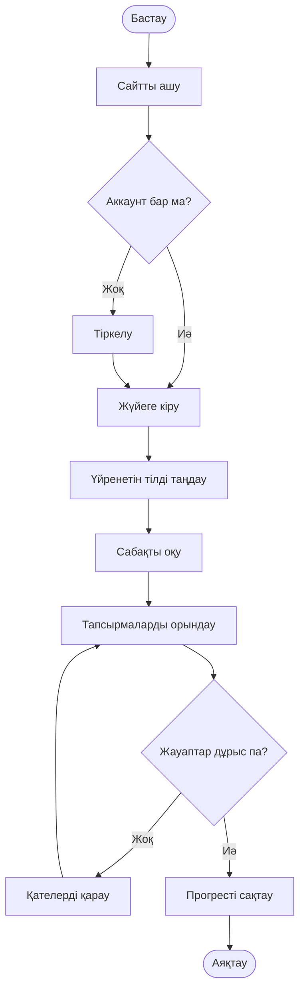

# 10
# 10-практикалық жұмыс

## Mermaid арқылы Use Case / Activity диаграммасын жасау

### Жұмыстың мақсаты

Mermaid көмегімен бағдарламалық жүйенің жұмыс сценарийін диаграмма түрінде көрсету және оны GitHub README файлына енгізу.

### Жобаның тақырыбы

**Тіл үйрену сайты**

### Сценарий сипаттамасы

Пайдаланушы тіл үйрену сайтына кіріп, жүйеге тіркеледі немесе аккаунтына кіреді. Содан кейін қажетті тілді таңдап, сабақтарды оқиды және тапсырмаларды орындайды. Жүйе тапсырмалардың нәтижесін тексеріп, пайдаланушының оқу прогресін сақтайды.

### Activity диаграммасы

### Нәтиже

Mermaid синтаксисі арқылы тіл үйрену сайтының Activity диаграммасы жасалды. Диаграмма пайдаланушының тіркелуден бастап сабақ орындау және оқу нәтижесін сақтау кезеңдеріне дейінгі әрекеттерін көрсетеді.

### Қорытынды

Бұл практикалық жұмыста Mermaid арқылы бағдарламалық жүйенің жұмыс сценарийін визуализациялау және диаграмманы GitHub README.md файлына енгізу тәсілі қарастырылды.
